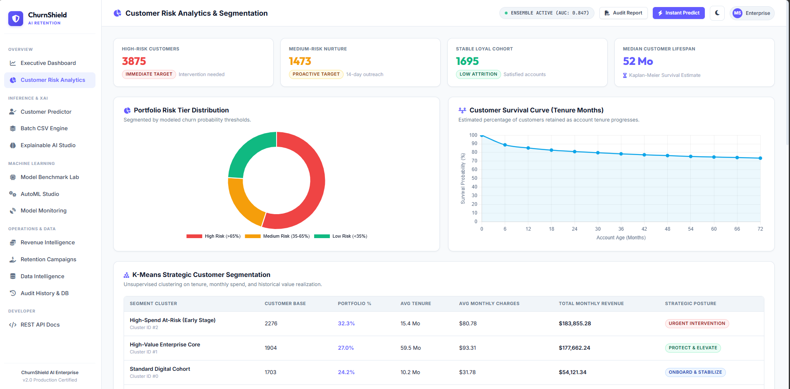
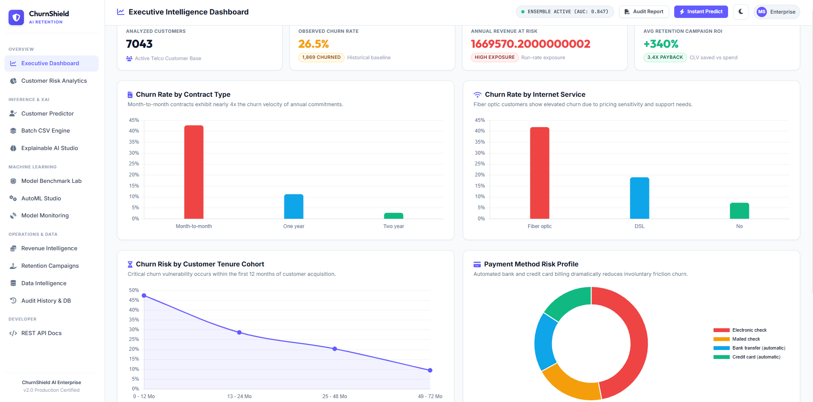
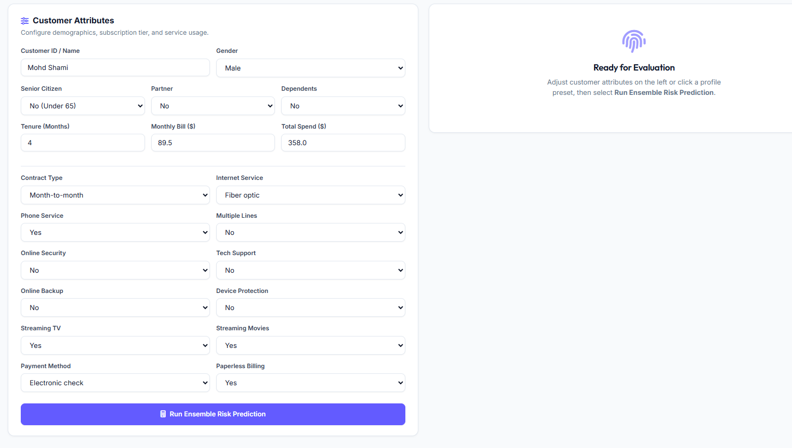
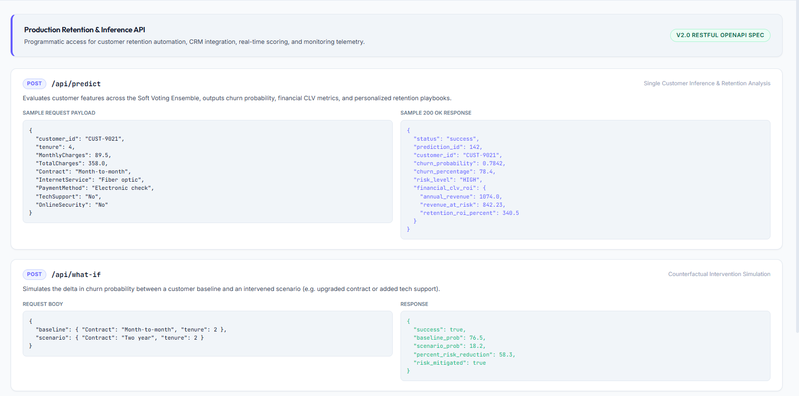

# 🛡️ ChurnShield AI — Enterprise Customer Retention Intelligence Platform

[](https://www.python.org/)
[](https://flask.palletsprojects.com/)
[](https://xgboost.readthedocs.io/)
[](https://shap.readthedocs.io/)
[]()

**ChurnShield AI** is a production-grade Customer Retention & Revenue Intelligence Platform engineered to predict customer churn risk, isolate the underlying root causes using cooperative game theory (SHAP), quantify revenue exposure, and deploy targeted financial retention playbooks.

---

##  Platform Architecture

```
ChurnShield_AI/
│
├── app.py                      # Primary Flask Application Entrypoint
├── run_flask.py                # Alternate CLI Server Runner
├── run_tests.py                # Unified Test Runner (Unittest + Custom Discovery)
├── requirements.txt            # Production Python Dependencies
├── data.csv                    # Reference Telco Customer Dataset (7,043 records)
├── churn_prediction.db         # Production SQLite Database (WAL mode enabled)
│
├── src/                        # Modular Intelligence Engine
│   ├── config.py               # Central Platform Settings & Model Paths
│   ├── data_loader.py          # Dynamic Schema Detection & Feature Engineering
│   ├── models.py               # Multi-Model Benchmark, Calibration & Threshold Tuner
│   ├── explainability.py       # SHAP TreeExplainer & Counterfactual Simulation
│   ├── retention_strategy.py   # CLV Preservation, Financial ROI & Playbooks
│   ├── analytics.py            # K-Means Segmentation & Survival Analysis
│   ├── monitoring.py           # PSI Data Drift & Model Health Monitoring
│   ├── profiler.py             # Dataset Quality Audit & Outlier Detection (IQR)
│   ├── reporting.py            # Printable Executive HTML / PDF & CSV Generator
│   └── database.py             # Data Access Layer (WAL mode, parameterized queries)
│
├── flask_app/                  # Enterprise Web Application Package
│   ├── __init__.py             # Flask Application Factory
│   ├── routes.py               # Web Views & REST API Endpoints
│   ├── static/
│   │   ├── css/style.css       # Cybernetic Glassmorphic Dark UI Theme
│   │   └── js/main.js          # Interactive Sliders, What-If Simulators & Presets
│   └── templates/              # Jinja2 Modular Templates
│       ├── base.html           # Unified Master Layout & Grouped Sidebar
│       ├── index.html          # Executive Intelligence Dashboard
│       ├── analytics.html      # Customer Risk Analytics & Segmentation
│       ├── customer_360.html   # Customer 360 Account Dossier & XAI
│       ├── predict.html        # Real-Time Predictor & What-If Studio
│       ├── batch.html          # High-Throughput Batch CSV/Excel Engine
│       ├── explainability.html # Explainable AI (XAI) & Global SHAP Studio
│       ├── models.html         # Model Performance Lab & Threshold Optimizer
│       ├── revenue.html        # Revenue Intelligence & 30/60/90-Day Projections
│       ├── retention.html      # Retention Campaign Studio & Playbooks
│       ├── automl.html         # AutoML Experiment Studio & Model Registry
│       ├── monitoring.html     # Model Monitoring & Data Drift Center
│       ├── data_intelligence.html # Data Intelligence & Profiling Studio
│       ├── history.html        # Audit History & Database Records
│       └── api_docs.html       # Interactive Developer OpenAPI Documentation
│
├── app/model/                  # Serialized Production Models
│   ├── churn_model.json        # XGBoost Booster
│   ├── rf_model.joblib         # Random Forest Classifier
│   ├── lr_model.joblib         # Logistic Regression (Balanced)
│   ├── ensemble_model.joblib   # Soft Voting Ensemble (Champion)
│   ├── scaler.joblib           # Pre-fitted StandardScaler
│   ├── feature_names.json      # 40-Feature Production Schema
│   └── metrics.json            # Model Evaluation Metrics
│
└── tests/                      # Comprehensive Unit & Integration Test Suite
    ├── test_platform_upgrade.py# Complete Tests for All New Routes & Services
    ├── test_flask_app.py       # Core Web Routes & REST API Tests
    ├── test_data_loader.py     # Schema Cleaning & Feature Extraction Tests
    ├── test_models.py          # Model Ingestion & Inference Tests
    ├── test_retention.py       # Financial CLV & Strategy Tests
    └── test_integration.py     # End-to-End Workflow & Edge-Case Tests
```

---

##  Core Modules & Platform Capabilities

### 1. Executive Intelligence Dashboard (`/`)
- Real-time KPIs: Customer base count, observed churn rate, annual revenue at risk, campaign ROI.
- Multi-dimensional analytics: Churn rate by contract, tenure cohort velocity, internet service type, and payment channel.

### 2. Customer Risk Analytics (`/analytics`)
- Risk tier breakdown: High Risk (>65%), Medium Risk (35-65%), Loyal (<35%).
- K-Means Strategic Clustering: Profiles customers into 4 clusters (`High-Value Core`, `At-Risk High Spenders`, `Tenured Savers`, `New Cohort`).
- Kaplan-Meier Survival Analysis: Probability of customer survival over a 72-month lifecycle.
- Interactive at-risk account table with instant access to individual Customer 360 views.

### 3. Customer 360 Dossier (`/customer/<customer_id>`)
- Detailed profile breakdown: demographics, contract terms, billing method, active services.
- Real-time churn probability score and risk badge.
- Local SHAP Waterfall Attribution: Dissects individual risk catalysts and retention anchors.
- Counterfactual Scenario Simulator: Shows the exact reduction in churn probability for 4 actionable retention strategies.
- Pre-drafted omnichannel communication copy (Email & SMS).

### 4. Prediction Studio (`/predict`)
- Profile presets: Instant testing for At-Risk, Loyal, and Enterprise profiles.
- Interactive form input with live probability calculation.
- What-If scenario simulation and direct persistence to SQLite database.

### 5. High-Throughput Batch Engine (`/batch`)
- CSV and Excel file ingestion with automatic schema validation.
- Batch vector inference with summary metrics and downloadable enriched CSVs.

### 6. Explainable AI (XAI) Studio (`/explainability`)
- Global feature importance (Mean |SHAP| values).
- Primary churn catalysts vs. retention anchors.
- Scientific causality notice distinguishing predictive correlation from causal mechanisms.

### 7. Model Performance Lab (`/models`)
- 5-Model Comparative Benchmark Matrix (Logistic Regression, Random Forest, HistGradientBoosting, XGBoost, Soft Voting Ensemble).
- Interactive ROC Curves and Precision-Recall Curves.
- Confusion matrix and calibration curve analysis.
- Decision Threshold Optimizer: Computes F1-maximizing cutoff and Business Cost-minimizing cutoff.

### 8. Revenue Intelligence (`/revenue`)
- Monthly Run-Rate (MRR) and Annual Recurring Revenue (ARR) at risk.
- 30, 60, and 90-day churn count and revenue loss projections.
- Interactive Retention Campaign ROI Simulator with real-time slider updates.

### 9. Retention Campaign Studio (`/retention`)
- Campaign deployment form with target risk tier, incentive offer, discount rate, and budget.
- Campaign tracking table monitoring targeted vs. retained counts and revenue saved.
- Tier-specific retention protocols (High, Medium, and Low-Risk).

### 10. AutoML Experiment Studio (`/automl`)
- One-click multi-model training pipeline with 5-fold stratified cross-validation.
- Automatic champion model registration based on ROC-AUC and F1-score.
- Version-controlled experiment logs in SQLite.

### 11. Model Monitoring Center (`/monitoring`)
- Population Stability Index (PSI) tracking across numerical features (`tenure`, `MonthlyCharges`, `TotalCharges`).
- Kolmogorov-Smirnov distribution shift testing.
- Overall Model Health Score (0-100%) and automated retraining alerts.

### 12. Data Intelligence Studio (`/data-intelligence`)
- Automated dataset profiling on uploaded or baseline data.
- Missing cell audits, duplicate row detection, and outlier identification via the Interquartile Range (IQR).
- Overall Data Quality Score (0-100%) and preprocessing roadmap.

---

## Project Screenshots

| Image | Preview |
|---|---|
| EDA |  |
| Image |  |
| Logistic Regression |  |
| Output 01 |  |
| Output 02 |  |
| Output 03 |  |
| Random Forest |  |
| XGBoost |  |


##  Quick Start Guide

### Prerequisites
- Python 3.10+
- Virtual environment (recommended)

### Installation

```bash
# 1. Clone repository
git clone https://github.com/mohdshamii/ChurnShield_AI.git
cd ChurnShield_AI

# 2. Install dependencies
pip install -r requirements.txt

# 3. Launch the platform
python app.py
```

Open your browser at: **`http://127.0.0.1:5000`**

*(Alternatively, run `python run_flask.py`)*

---

##  Running the Test Suite

```bash
# Run full automated test suite (40 unit and integration tests)
python run_tests.py
```

Or via pytest:
```bash
pytest tests/
```

---

## 🔌 REST API Endpoints

| Method | Endpoint | Description |
|---|---|---|
| `POST` | `/api/predict` | Single customer inference with XAI drivers and retention playbooks |
| `POST` | `/api/what-if` | Counterfactual scenario simulation (calculates risk delta) |
| `GET` | `/api/models` | Production benchmark matrix and model metrics |
| `GET` | `/api/monitoring/drift` | Population Stability Index (PSI) and data drift telemetry |
| `POST` | `/api/save-prediction` | Persist an evaluated customer record to database |
| `POST` | `/api/delete-prediction/<id>` | Remove a record from prediction history |
| `GET` | `/api/export-history` | Download full prediction history as CSV |
| `GET` | `/download-report` | Generate self-contained executive printable / PDF audit report |

---

## 👤 Developer & Contact

**Mohd Shami**  
- **LinkedIn:** [linkedin.com/in/mohdshamii](https://www.linkedin.com/in/mohdshamii)  
- **Email:** codexshami@gmail.com  
- **GitHub:** [github.com/mohdshamii](https://github.com/mohdshamii)  

*License: MIT*
